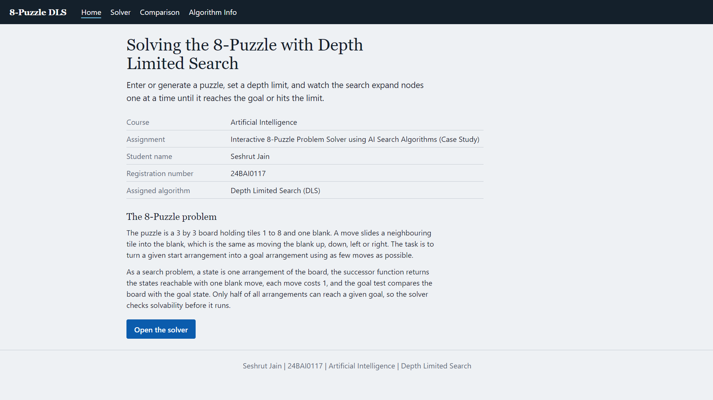
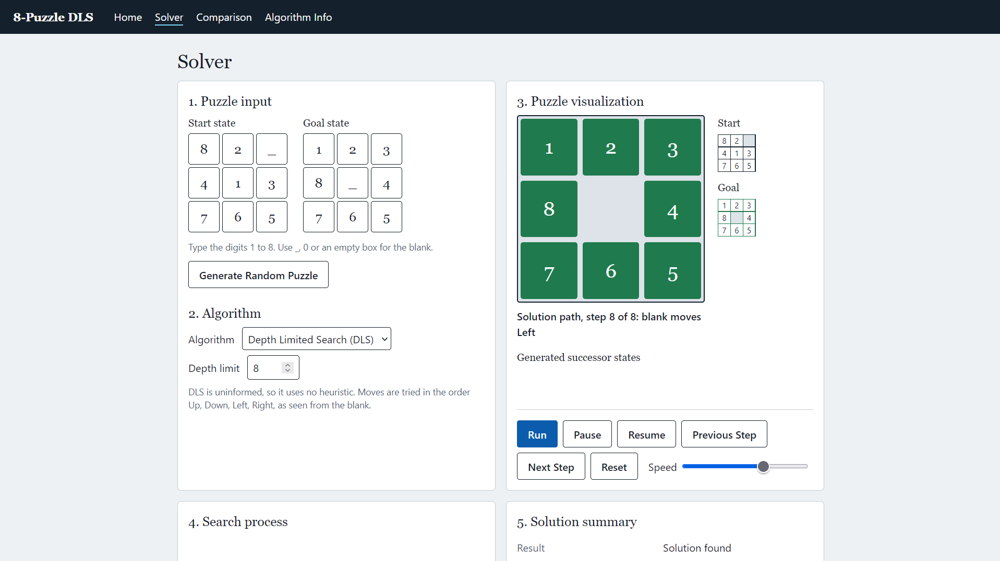
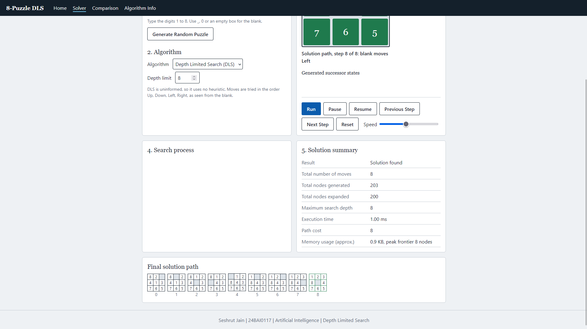
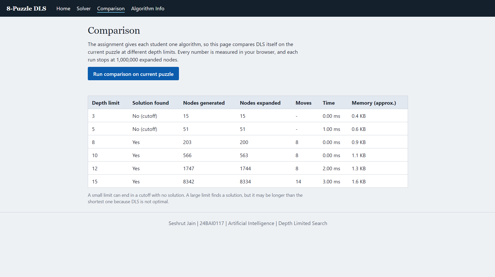

# AI-8Puzzle-Visualizer

## Project Description
An interactive web application that solves the 8-Puzzle problem with Depth Limited Search (DLS) and shows how the search works, one step at a time.

The user can type an initial and goal state or generate a random solvable puzzle, set a depth limit, and then run the search. While it runs, the page shows:

- the current board, with the blank tile's movement animated
- the node being expanded and the successor states it generates
- nodes generated and expanded, current depth, parent node, path cost, the frontier (stack) and the explored count
- the final solution path and a summary (moves, nodes generated and expanded, maximum depth, execution time, path cost, approximate memory)

Playback has Run, Pause, Resume, Next Step, Previous Step, Reset and a speed control. A comparison page runs DLS on the current puzzle at several depth limits, and an information page documents the algorithm.

Course: Artificial Intelligence. Assignment: Interactive 8-Puzzle Problem Solver using AI Search Algorithms (Case Study).

## Technologies Used
- HTML5, CSS3, JavaScript (ES6 modules)
- React 18, loaded from the esm.sh CDN (no Node.js, npm or build step)
- htm, which lets React components be written as HTML templates without JSX
- Tailwind CSS (UI framework), loaded from its CDN
- GSAP (animation library for tile movement and successor states)
- GitHub Pages (deployment)

## Search Algorithms Implemented
**Depth Limited Search (DLS)**, written from scratch in `js/logic/depthLimitedSearch.js`.

- Uses an explicit stack, so the most recently generated node is expanded first.
- Tests for the goal when a node is expanded.
- Does not expand nodes at the depth limit.
- Skips successors that already appear on the current path, which avoids loops without storing every visited state.
- Ends with one of four results: solution found, cutoff (the limit stopped the search, so a deeper goal may exist), failure (the whole space was searched), or a safety stop at 2,000,000 expanded nodes.

DLS is not optimal, so the path it returns can be longer than the shortest one. It is complete only when the depth limit is at least the depth of the shallowest goal.

## Heuristics Used
None. DLS is an uninformed search, so heuristics such as Misplaced Tiles and Manhattan Distance do not apply to it. They belong to the informed searches (GBFS and A*), which are assigned to other students.

## Screenshots
Home page:



Solver with search in progress:



Solution summary and path:



Comparison page:



## GitHub Pages URL
https://seshrutvit.github.io/AI-8Puzzle-Visualizer

## Student Details
| | |
|---|---|
| Name | Seshrut Jain |
| Registration number | 24BAI0117 |
| Course | Artificial Intelligence |
| Assigned algorithm | 3, Depth Limited Search |

## References
- S. Russell and P. Norvig, *Artificial Intelligence: A Modern Approach*, chapter 3, Solving Problems by Searching.
- React documentation, https://react.dev
- htm documentation, https://github.com/developit/htm
- Tailwind CSS documentation, https://tailwindcss.com/docs
- GSAP documentation, https://gsap.com/docs
- esm.sh CDN, https://esm.sh
- GitHub Pages documentation, https://docs.github.com/pages

The search algorithm, puzzle logic and interface code are original work for this assignment. No other third-party code or images are used.

## How to Run the Project
No installation is needed. The libraries load from the internet, so an internet connection is required.

The code uses ES modules, which browsers block when a page is opened by double-clicking `index.html`. Serve the folder instead, using either of these:

- VS Code: install the Live Server extension, then right-click `index.html` and choose Open with Live Server.
- Python: run `python -m http.server 8000` in the project folder and open http://localhost:8000.

**Deploying to GitHub Pages:** push the repository to GitHub, open Settings > Pages, set Source to "Deploy from a branch", choose the `main` branch and the `/ (root)` folder, and save. The site is live at the URL above after a minute or two.

## Project structure
```
index.html          page shell, loads Tailwind, React, htm and GSAP
css/style.css       colours and reusable component styles
js/main.js          starts the app
js/App.js           navigation and page layout
js/pages/           Home, Solver, Comparison, AlgorithmInfo
js/components/      Board, MiniBoard, StateGrid, Controls, SearchDetails, SolutionSummary
js/hooks/           playback timer, puzzle settings, hash navigation
js/logic/           puzzle rules and the DLS algorithm (no React)
js/content/         written text for the Home and Algorithm Information pages
assets/             favicon
images/, docs/      screenshots
```